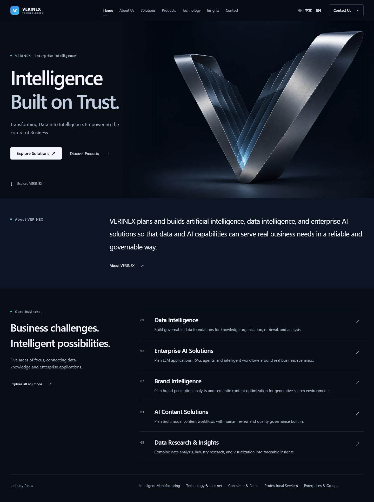

# VERINEX TECHNOLOGIES 官网

VERINEX 企业官网 MVP。项目采用 Vue 3 + TypeScript 构建响应式双语前端，以 ASP.NET Core 10 + EF Core 10 提供内容与联系表单 API，并通过 MySQL、Nginx 和 Docker Compose 组成可部署的完整应用。

> 项目当前处于建设阶段。仓库内产品状态均为 `PLANNED`，示例文章仅用于展示网站结构，不代表已发布产品、客户项目或正式研究结论。



## 项目特性

- 中英文站点与带语言前缀的规范路由：`/zh/*`、`/en/*`
- 首页、关于、解决方案、产品、技术、洞察、联系及详情页
- 桌面、平板、移动端响应式布局与键盘可访问性
- Vue I18n 固定文案国际化，数据库业务内容采用主表 + 翻译表
- 内容 API、联系表单服务端验证、限流与 RFC 7807 ProblemDetails
- EF Core Migration、幂等 Seed、MySQL `utf8mb4` 与 UTC 时间
- 一级页面预渲染、详情页 SEO、canonical、hreflang、JSON-LD 与动态 sitemap
- xUnit 单元/集成测试和 Playwright 多视口端到端测试
- Docker 多阶段构建、Nginx 同源反向代理及完整健康检查

## 技术栈

| 层级 | 技术 |
| --- | --- |
| 前端 | Vue 3、TypeScript、Vite、Vue Router、Pinia、Vue I18n、Axios、SCSS |
| 后端 | ASP.NET Core 10 Web API、C#、EF Core 10、OpenAPI |
| 数据库 | MySQL 8.4 LTS、MySqlConnector |
| 测试 | Playwright、xUnit、WebApplicationFactory |
| 部署 | Docker、Docker Compose、Nginx；可选 Cloudflare Tunnel |

## 项目结构

```text
verinex/
├── frontend/                 # Vue 前端、Nginx 配置、Playwright 测试
├── backend/
│   ├── src/Verinex.Api/      # Web API、业务服务、EF Core、Migration/Seed
│   └── tests/                # xUnit 单元测试与 API 集成测试
├── docs/                     # PRD、架构、数据库、API 与设计规范
├── design/                   # Pixso 视觉基准与设计素材
├── docker-compose.yml        # MySQL、API、Web 与可选隧道编排
├── .env.example              # 本地环境变量模板
└── deploy.ps1                # 当前站点环境的一键部署脚本
```

详细设计请参阅 [`docs/ARCHITECTURE.md`](docs/ARCHITECTURE.md)、[`docs/DATABASE.md`](docs/DATABASE.md)、[`docs/API.md`](docs/API.md) 和 [`docs/DESIGN_SPEC.md`](docs/DESIGN_SPEC.md)。

## 快速启动

### 前置条件

- Docker Desktop（含 Docker Compose）
- 可用端口：`8081`（网站）和仅回环绑定的 `8080`（API 联调）
- 仅做前端源码开发时：Node.js `>= 20.19`，推荐 Node.js 22
- 仅在宿主机编译后端时：.NET SDK 10

### 使用 Docker Compose

首次启动时创建本地配置，并为两个数据库账户设置不同的强口令：

```powershell
Copy-Item .env.example .env
# 编辑 .env：填写 MYSQL_ROOT_PASSWORD 与 MYSQL_PASSWORD
docker compose config --quiet
docker compose up -d --build mysql api web
docker compose ps
```

`mysql`、`api`、`web` 均显示 `healthy` 后访问：

- 中文站：<http://localhost:8081/zh>
- 英文站：<http://localhost:8081/en>
- API 就绪检查：<http://localhost:8081/health/ready>
- 站点地图：<http://localhost:8081/sitemap.xml>

停止服务但保留 MySQL 数据：

```powershell
docker compose down
```

不要附加 `--volumes`；数据库数据保存在 `mysql-data` 命名卷中。

`cloudflared` 服务依赖宿主机已有的 `~/.cloudflared/verinex.yml` 和隧道凭据，不属于普通本地启动流程。没有这些配置时请保持使用上面的 `mysql api web` 服务列表。

## 本地源码开发

先启动数据库与 API：

```powershell
docker compose up -d --build mysql api
```

再启动前端开发服务器：

```powershell
Set-Location frontend
npm ci
npm run dev
```

前端地址为 <http://localhost:5173/zh>。Vite 会把 `/api` 代理到 `http://localhost:8080`。

直接在宿主机编译后端：

```powershell
Set-Location backend
dotnet build Verinex.sln -c Release
dotnet test Verinex.sln -c Release --no-build
```

没有安装 .NET SDK 10 时，可使用 SDK 容器：

```powershell
docker run --rm --mount "type=bind,source=$((Get-Location).Path)\backend,target=/src" --workdir /src mcr.microsoft.com/dotnet/sdk:10.0 dotnet build Verinex.sln -c Release
docker run --rm --mount "type=bind,source=$((Get-Location).Path)\backend,target=/src" --workdir /src mcr.microsoft.com/dotnet/sdk:10.0 dotnet test Verinex.sln -c Release --no-build
```

## API 概览

公开 API 使用 `/api/v1` 前缀。双语读取接口通过 `lang=zh-CN` 或 `lang=en` 选择语言；完整请求、响应与错误契约以 [`docs/API.md`](docs/API.md) 为准。

| 方法 | 路径 | 用途 |
| --- | --- | --- |
| `GET` | `/api/v1/site/overview` | 首页聚合内容 |
| `GET` | `/api/v1/company` | 企业介绍 |
| `GET` | `/api/v1/solutions`、`/{slug}` | 解决方案列表与详情 |
| `GET` | `/api/v1/products`、`/{slug}` | 产品列表与详情 |
| `GET` | `/api/v1/technologies` | 技术能力 |
| `GET` | `/api/v1/industries` | 行业列表 |
| `GET` | `/api/v1/insights`、`/{slug}` | 洞察列表与文章详情 |
| `POST` | `/api/v1/contact` | 提交联系留言 |
| `GET` | `/health/live`、`/health/ready` | 存活与数据库就绪检查 |
| `GET` | `/sitemap.xml` | 动态站点地图 |

OpenAPI 文档仅在 `Development` 或 `Testing` 环境映射。

## 测试与验证

前端：

```powershell
Set-Location frontend
npm ci
npm run typecheck
npm run build
npx playwright install chromium
npm run test:e2e
```

Playwright 在 `1920 × 1080`、`1440 × 900`、`768 × 1024`、`390 × 844` 四个视口验证页面加载、导航、语言切换、详情页、SEO 与联系表单。联系表单完整流程需要本地 API 与 MySQL 正常运行。

后端：

```powershell
Set-Location backend
dotnet build Verinex.sln -c Release
dotnet test Verinex.sln -c Release --no-build
```

## 环境变量

真实配置只写入未纳入版本控制的 `.env` 或部署平台密钥管理。不要提交口令、证书、隧道凭据或生产配置。

| 变量 | 必填 | 默认值 | 用途 |
| --- | --- | --- | --- |
| `MYSQL_ROOT_PASSWORD` | 是 | 无 | MySQL 管理口令，仅用于初始化与运维 |
| `MYSQL_DATABASE` | 否 | `verinex` | 应用数据库名 |
| `MYSQL_USER` | 否 | `verinex` | 应用数据库账号，不使用 root |
| `MYSQL_PASSWORD` | 是 | 无 | 应用数据库口令 |
| `WEB_PORT` | 否 | `8081` | Nginx 映射到宿主机的端口 |
| `SITE_PUBLIC_BASE_URL` | 生产必填 | `http://localhost:8081` | canonical 与 sitemap 使用的公开根地址 |
| `DATABASE_INITIALIZE_ON_STARTUP` | 否 | `true` | 启动时应用 Migration 并执行幂等 Seed；生产常态应设为 `false` |

前端源码开发可从 `frontend/.env.example` 创建本地环境文件，并设置 `VITE_API_BASE_URL`。Docker 部署由 Nginx 同源代理，不需要把 API 地址写入前端构建产物。

## 运行架构

```text
浏览器 :8081
  └─ web（Nginx + Vue 静态文件）
       ├─ /api/*、/health/*、/sitemap.xml → api:8080
       └─ 其他路径 → 预渲染 HTML 或 Vue 应用外壳
            api（ASP.NET Core 10）
              └─ mysql:3306（仅 Compose 内部网络）
```

- `mysql`：通过 `mysqladmin ping` 检查；端口不向宿主机或公网开放。
- `api`：通过 `/health/ready` 同时检查 API 和数据库连接。
- `web`：经 Nginx 请求 `/health/ready`，验证整条反向代理链路。
- 启动顺序：`mysql healthy → api healthy → web`。

查看状态和日志：

```powershell
docker compose ps
docker compose logs --tail 200 api web mysql
```

## 部署注意事项

以下流程适用于自托管 Docker 主机。正式发布、生产迁移、域名切换和隧道配置必须经项目负责人确认。

1. 准备 Docker Compose 主机，并配置 HTTPS 终止层、防火墙和正式域名。
2. 从 `.env.example` 创建生产 `.env`，使用密钥管理生成强口令。
3. 设置 `SITE_PUBLIC_BASE_URL=https://正式域名` 和 `DATABASE_INITIALIZE_ON_STARTUP=false`。
4. 发布前备份数据库并审查待应用的 EF Core Migration。
5. 仅在确认的迁移窗口执行迁移；完成后保持自动迁移关闭。
6. 构建并启动 `mysql api web`，等待所有健康检查通过。
7. 验证中英文页面、内容 API、联系表单、健康检查和站点地图。
8. 复查 HTTPS、HSTS、canonical、hreflang、robots.txt 和浏览器控制台。

仓库中的 `deploy.ps1` 包含当前 VERINEX 环境的 Cloudflare 公网检查，不是通用部署脚本；在其他主机或域名使用前必须先审查并调整。当前 Nginx 容器仅提供 HTTP，生产 HTTPS/HSTS 应由主机反向代理、负载均衡器或已审核的 Tunnel 配置负责。

## 数据与安全

- `.env`、生产配置、证书、隧道凭据和数据库备份均被排除在版本控制之外。
- 联系留言包含个人信息，应最小化采集并限制数据库与备份访问。
- 服务端限制请求体大小、字段长度和提交频率；日志不得记录完整留言或密钥。
- 生产迁移前必须备份，且不得通过删除 `mysql-data` 卷代替迁移或恢复。
- 数据库恢复属于破坏性操作，必须在停止写入并获得明确确认后执行。

## 文档索引

- [产品需求](docs/PRD.md)
- [系统架构](docs/ARCHITECTURE.md)
- [数据库设计](docs/DATABASE.md)
- [API 契约](docs/API.md)
- [视觉规范](docs/DESIGN_SPEC.md)
- [MySQL Provider 技术决策](docs/ADR-001-mysql-provider.md)

## 许可

本仓库目前未声明开源许可证。除非仓库所有者另行授权，代码、设计和品牌素材保留其原有权利。
