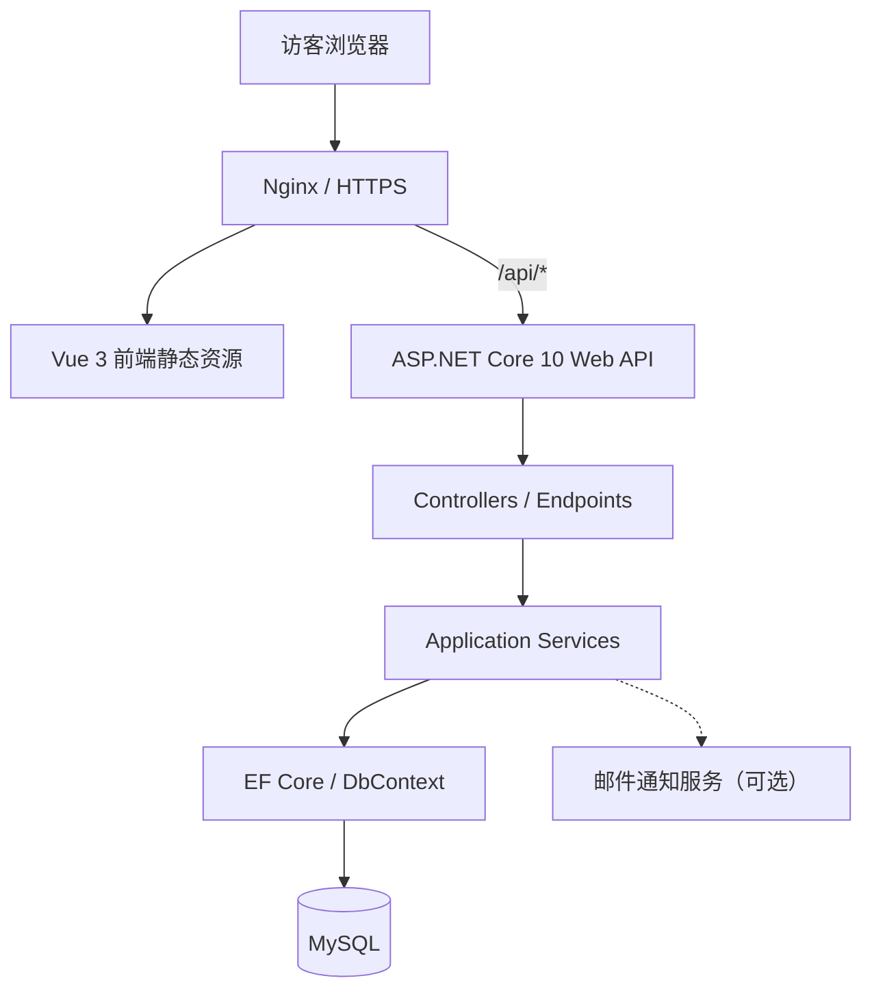
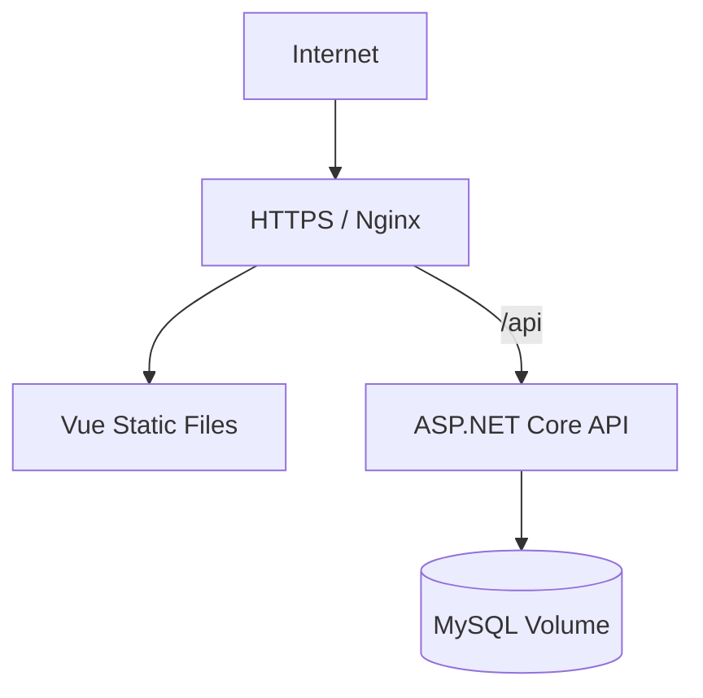

# VERINEX 技术架构设计文档

> 项目：VERINEX TECHNOLOGIES 官方网站  
> 文档：ARCHITECTURE.md  
> 版本：V1.1  
> 状态：开发基线（已与 PRD V1.1、DATABASE V1.1、API V1.1 和 Pixso 设计稿对齐）  
> 前端：Vue 3 + TypeScript + Vite  
> 后端：ASP.NET Core 10 + C#  
> 数据库：MySQL 8.4 LTS（部署前核对目标环境）

## 1. 文档目的与依据

本文定义 VERINEX 官网的总体技术架构、模块边界、数据流、部署方式和工程约束，供项目负责人、Codex 和后续开发人员共同遵循。

项目中的产品功能以 `docs/PRD.md` 为准；页面视觉、布局、组件和交互以最终确认的 Pixso 设计稿及 `design/` 下的导出资料为准；技术实现以本文为基线。若这些资料相互冲突，Agent 必须先报告冲突及影响，不得自行覆盖已确认决策。

当前方案基于已经确认的项目方向：综合型 AI 科技企业官网、技术研发与产品平台并重、中英文双语、Pixso 设计、Codex 辅助开发、Vue 3 前端、ASP.NET Core 后端和 MySQL 数据库。正式实施前仍需对照用户最终 PRD 和原型逐项核验。

## 2. 项目定位与范围

### 2.1 网站目标

VERINEX 官网用于：

- 展示企业品牌定位、使命、愿景和公司介绍。
- 展示五大业务方向及其解决方案。
- 展示五个规划中的产品平台及产品成熟度。
- 展示 AI 技术能力、行业洞察和文章内容。
- 支持中文与英文访问。
- 提供商务联系表单，并将客户留言持久化到 MySQL。
- 为后续内容管理后台预留清晰的数据和 API 边界。

### 2.2 业务板块

1. Data Intelligence：数据智能与知识资产。
2. Enterprise AI Solutions：企业人工智能解决方案。
3. Brand Intelligence：AI 品牌智能与 GEO。
4. AI Content Solutions：AI 内容智能与数字传播。
5. Data Research & Insights：数据研究与行业洞察。

### 2.3 产品平台

- VERICORPUS：企业数据与知识资产平台。
- VERIMIND：企业 AI 智能应用平台。
- VERISTUDIO：AI 内容与品牌智能平台。
- VERIINSIGHT：数据分析与行业洞察平台。
- VERIBRAND：AI 品牌认知与 GEO 平台。

这些名称代表当前规划的产品体系。产品是否已经上线必须由项目负责人确认，数据库和页面应区分 PLANNED、IN_DEVELOPMENT、RELEASED，不得把规划产品描述为已交付产品。

### 2.4 版本范围

**第一阶段（官网 MVP）：** 公开展示页面、双语、产品/业务/技术/文章内容读取、联系表单、留言持久化、基础 SEO、响应式适配、部署。

**第二阶段：** 管理员认证、内容管理后台、产品/解决方案/文章 CRUD、媒体管理、留言管理。

除非 PRD 明确要求，第一阶段不开发完整 CMS、不开发访客账号体系、不开发真实 AI 产品控制台，也不引入微服务。

## 3. 架构原则

1. **前后端分离：** Vue 前端通过 HTTP API 与 ASP.NET Core 通信，浏览器不直接连接 MySQL。
2. **模块化单体：** 后端作为一个可独立部署的 ASP.NET Core 应用，按业务模块组织代码；当前不拆微服务。
3. **简单优先：** 只引入当前需求真正需要的组件，避免为了架构形式增加复杂度。
4. **明确分层：** HTTP 处理、业务逻辑、领域实体和持久化访问保持职责清晰。
5. **双语内容一致：** 业务实体与语言翻译分离，通过 locale 关联，不复制两份业务主记录。
6. **设计稿驱动 UI：** Pixso 确认稿是视觉还原基准，不能用 Agent 自行发挥替代。
7. **安全默认：** 服务端验证输入、保护密钥、限制公开写接口、避免暴露内部异常。
8. **可验证交付：** 每项功能需要编译、测试和实际运行验证，不能仅凭代码生成完成判定。

## 4. 技术选型

| 层级 | 技术 | 责任 |
|---|---|---|
| 前端框架 | Vue 3 | 页面和组件 |
| 前端语言 | TypeScript | 类型约束 |
| 构建工具 | Vite | 开发与构建 |
| 路由 | Vue Router | 页面路由 |
| 状态管理 | Pinia | 必要的跨页面状态 |
| 国际化 | Vue I18n | 固定 UI 文案双语 |
| HTTP | Axios | API 请求（全项目统一使用 Axios，不混用 fetch） |
| 样式 | CSS / SCSS | Design Tokens 与页面样式 |
| 动画 | CSS 优先，GSAP 按需 | 交互动效 |
| 3D | Three.js 按需 | 只有设计稿明确需要时引入 |
| 后端 | ASP.NET Core 10 Web API | API 与服务端业务 |
| 语言 | C# | 后端实现 |
| ORM | EF Core 10 | 数据访问和迁移 |
| 数据库 | MySQL 8.4 LTS | 持久化 |
| API 文档 | OpenAPI / Swagger | 接口说明 |
| 测试 | xUnit、WebApplicationFactory、Playwright | 后端与浏览器测试 |
| 部署 | Docker、Docker Compose、Nginx | 容器化与反向代理 |
| 版本控制 | Git | 变更管理 |

**依赖兼容要求：** MySQL EF Core Provider 必须明确支持项目采用的 EF Core 主版本。安装前核对 Provider 的官方兼容矩阵和维护状态，不得为了使用某个 Provider 擅自降级 .NET 或 EF Core。所有依赖版本应锁定并提交 lock 文件或项目文件。

## 5. 总体系统架构



### 5.1 请求流程

1. 用户访问官网，Nginx 返回前端静态资源。
2. Vue 根据 URL 语言前缀渲染对应页面。
3. 页面通过 API 获取已发布的企业、产品、业务、技术或文章数据。
4. Nginx 将 `/api/` 请求反向代理到 ASP.NET Core。
5. Controller 进行 HTTP 层参数绑定和验证，调用业务服务。
6. Service 使用 EF Core 查询 MySQL，组装 Response DTO。
7. API 返回 JSON，前端负责展示。
8. 联系表单由后端验证并保存；邮件通知为可选副作用，邮件失败不能导致已保存留言丢失。

## 6. 前端架构

### 6.1 建议目录

```text
frontend/
├── public/
│   ├── favicon.ico
│   └── robots.txt
├── src/
│   ├── api/                 # API client 与各业务接口
│   ├── assets/              # 本地图片、字体、图标
│   ├── components/          # 可复用组件
│   ├── layouts/             # 全站布局
│   ├── views/               # 页面
│   │   ├── Home/
│   │   ├── About/
│   │   ├── Solutions/
│   │   ├── Products/
│   │   ├── Technology/
│   │   ├── Insights/
│   │   └── Contact/
│   ├── router/              # 路由
│   ├── stores/              # Pinia（确有共享状态时使用）
│   ├── i18n/                # zh-CN / en 固定 UI 文案
│   ├── styles/              # reset、tokens、global styles
│   ├── types/               # API 与业务类型
│   ├── App.vue
│   └── main.ts
├── package.json
└── vite.config.ts
```

目录可以根据实际生成的工程适当调整，但必须保持职责清晰，禁止把所有页面、请求和样式堆在单个文件中。

### 6.2 路由与语言

建议使用语言前缀：

```text
/zh/                         首页
/zh/about                    关于我们
/zh/solutions                解决方案
/zh/solutions/:slug          解决方案详情
/zh/products                 产品中心
/zh/products/:slug           产品详情
/zh/technology               技术能力
/zh/insights                 行业洞察
/zh/insights/:slug           文章详情
/zh/contact                  联系我们

/en/                         English home
/en/about
/en/solutions
/en/solutions/:slug
/en/products
/en/products/:slug
/en/technology
/en/insights
/en/insights/:slug
/en/contact
```

实际 slug 和路由以 PRD、Pixso 原型及 API 契约为准。语言切换应尽量映射到同一内容的另一语言 URL；若目标语言内容不存在，提供明确提示或回退到该语言首页，不得静默显示另一语言正文。

### 6.3 国际化职责

- Vue I18n 管理导航、按钮、表单提示、错误提示等固定 UI 文案。
- MySQL 翻译表管理公司介绍、产品、解决方案、技术能力和文章等内容。
- 页面语言由 URL 前缀决定，API 请求传递 `lang`。
- 所有可见文案必须进入语言资源或数据库翻译，不得在组件中散落硬编码中英文。

### 6.4 设计系统

从 Pixso 最终稿提取并集中管理：

- 品牌色、背景色、文字色、状态色。
- 字体族、字号、字重、行高。
- 页面容器宽度和网格。
- 间距、圆角、边框、阴影。
- 按钮、导航、卡片、表单等组件状态。
- 断点、动效时长和 easing。

建议使用 CSS Variables / Design Tokens。具体数值以 Pixso 为准，不得把早期概念稿中的颜色和尺寸当成最终设计规范。

### 6.5 SEO 渲染策略

V1 采用“静态页预渲染 + 详情页客户端渲染”：

- 七个一级页面和 `/zh`、`/en` 语言首页在构建期通过 Vite 预渲染插件输出独立 HTML，保证首屏内容可被爬虫直接抓取。
- 产品、解决方案、文章详情页内容来自数据库，保持客户端渲染，由前端统一管理 title、description、canonical、hreflang 和 Open Graph；`sitemap.xml` 由后端依据已发布内容生成，`robots.txt` 随前端发布。
- 预渲染只依赖构建期可确定的静态路由，不引入 SSR 服务端运行时，部署结构保持不变。
- 若预渲染插件与现有依赖冲突，先记录问题并给出降级方案（纯 SPA + 完整的 meta 与 sitemap），由项目负责人确认后再决定，不得擅自更换前端框架。

## 7. 后端架构

### 7.1 架构模式

采用 ASP.NET Core 10 模块化单体。MVP 先使用一个 Web API 项目，通过业务模块和清晰的文件夹组织代码；不为了形式拆分多个 Class Library。若后续业务复杂度明显增加，再通过 ADR 评估拆分 Application、Domain、Infrastructure 项目。

### 7.2 建议目录

```text
backend/
├── Verinex.sln
├── src/
│   └── Verinex.Api/
│       ├── Controllers/
│       ├── Features/
│       │   ├── Site/
│       │   ├── Company/
│       │   ├── Solutions/
│       │   ├── Products/
│       │   ├── Technology/
│       │   ├── Industries/
│       │   ├── Insights/
│       │   └── Contacts/
│       ├── Domain/
│       │   ├── Entities/
│       │   └── Enums/
│       ├── Data/
│       │   ├── AppDbContext.cs
│       │   ├── Configurations/
│       │   ├── Migrations/
│       │   └── Seed/
│       ├── Infrastructure/
│       │   └── Email/
│       ├── Common/
│       │   ├── Exceptions/
│       │   └── Results/
│       ├── Middleware/
│       ├── Program.cs
│       └── appsettings.json
└── tests/
    ├── Verinex.UnitTests/
    └── Verinex.IntegrationTests/
```

### 7.3 分层职责

- **Controller：** HTTP 路由、参数绑定、调用应用服务、设置状态码；不放复杂业务逻辑。
- **Service：** 业务规则、内容查询、语言选择、留言提交流程。
- **Domain：** 实体、枚举和必要的业务约束。
- **Data：** DbContext、EF Core Fluent Configuration、Migration、Seed。
- **Infrastructure：** 邮件发送、文件/媒体存储等外部能力。
- **Middleware：** 异常处理、请求日志和必要的请求上下文。

不强制使用 Repository Pattern。常规 EF Core 查询优先由 Service 使用 DbContext 完成；只有出现明确的复用或隔离需求时才增加 Repository。

### 7.4 通用实现要求

- 使用依赖注入管理服务。
- I/O 操作优先使用 async/await，并传递 CancellationToken。
- 使用 Request DTO 和 Response DTO，不直接暴露 EF Entity。
- 开启 Nullable Reference Types。
- 通过 Fluent Validation 或 Data Annotations 等一种统一方式进行请求验证，避免重复规则。
- 使用 ProblemDetails 作为错误响应标准。
- 不吞异常；记录必要上下文但不记录密钥和完整敏感留言。

## 8. 数据架构

MySQL 是业务内容和联系留言的持久化存储。数据库详细表结构、字段、索引和约束以 `docs/DATABASE.md` 为准。

核心实体：

- CompanyProfile / CompanyProfileTranslation
- Solution / SolutionTranslation
- Product / ProductTranslation
- TechnologyCapability / TechnologyTranslation
- Industry / IndustryTranslation
- Article / ArticleTranslation
- ContactMessage
- SiteSetting
- MediaAsset / MediaAssetTranslation（第二阶段启用，V1 不建表）

双语实体采用主表 + 翻译表。主表保存与语言无关的状态、排序、代码和时间；翻译表保存 locale、slug、标题、摘要、正文及 SEO 文案。

V1 封面图使用 `products.cover_image_url` / `articles.cover_image_url` 存 URL，不依赖媒体表；后台上传与对象存储属于第二阶段。

所有时间按 UTC 存储；表名使用 snake_case；字符集使用 utf8mb4；数据库结构通过 EF Core Migrations 管理。

## 9. API 设计原则

- API 前缀统一为 `/api/v1`。
- 使用 REST 风格资源路径和正确 HTTP 方法。
- 内容查询通过 `lang=zh-CN` 或 `lang=en` 指定语言，默认 `zh-CN`。
- 列表接口使用分页，限制最大 pageSize。
- 成功响应采用统一 `data` 结构；分页额外提供 `meta`。
- 错误响应采用 RFC 7807 风格 ProblemDetails。
- 公开 GET 接口只返回已发布内容。
- 公开写接口 MVP 仅包含联系表单；不得开放内容写入接口。
- 完整端点和 DTO 以 `docs/API.md` 为准。

## 10. 安全与隐私

### 10.1 公开访问

MVP 的产品、解决方案、公司、技术、行业和文章接口为公开只读接口。联系表单是公开写接口，必须有服务端验证、长度限制、频率限制和反垃圾措施。

### 10.2 管理后台

MVP 不包含管理后台和管理员登录，不提前实现无需求的 JWT 或权限系统。第二阶段如开发 CMS，另行确定认证方式、角色权限、审计日志和安全策略。

### 10.3 安全要求

- 所有输入在服务端验证。
- 使用 EF Core 参数化访问，禁止拼接不可信 SQL。
- 生产环境使用 HTTPS。
- 开发环境 CORS 只允许明确的本地开发源；生产同源部署优先由 Nginx 反向代理，不开放宽泛 CORS。
- 限制请求体大小和表单字段长度。
- 通过可信代理配置正确识别客户端 IP，不能盲信任任意 X-Forwarded-For。
- 生产错误响应不得返回堆栈和连接字符串。
- 密钥放在环境变量或受控密钥系统中，不提交仓库。
- 联系留言属于个人信息，最小化采集、限制访问、制定保留与删除规则。

## 11. 性能与可访问性

- 图片优先使用 WebP/AVIF，并提供合适尺寸。
- 首屏关键资源优先加载，非首屏图片懒加载。
- 复杂 3D 动效按需加载，并提供静态降级方案。
- 动效不应阻塞主线程；支持 `prefers-reduced-motion`。
- 页面应支持键盘导航，表单有清晰 label 和错误提示。
- 颜色对比度、焦点状态和图片替代文本应符合基本可访问性要求。
- 文章列表必须分页，不一次性加载全部内容。

## 12. 测试策略

- 前端：TypeScript 检查、ESLint、生产构建、Playwright 页面与交互测试。
- 后端：xUnit 单元测试、WebApplicationFactory 集成测试。
- 数据库：迁移验证、约束验证、双语查询验证。
- API：状态码、参数校验、未发布内容不可见、语言缺失处理、分页边界。
- UI：使用 Pixso 确认稿的视口尺寸做截图对比，并检查桌面、平板、移动端。
- 联系表单：成功提交、无效邮箱、缺少同意、超长字段、重复/频繁提交、数据库失败。

测试必须真实执行并记录结果。缺少外部环境时应明确标记为未验证，不能报告为通过。

## 13. 部署架构

建议使用 Docker Compose 部署以下服务：

- `web`：Nginx + Vue 构建产物，负责静态文件和 `/api` 反向代理。
- `api`：ASP.NET Core Web API。
- `mysql`：MySQL，使用持久化 Volume，生产环境不将数据库端口暴露到公网。



环境至少区分 Development、Test、Production。生产配置通过环境变量注入。部署前备份数据库，执行迁移前进行审查；正式发布和破坏性迁移必须由项目负责人确认。

## 14. 阶段规划

### Phase 1：官网 MVP

- 工程初始化和基础设计系统。
- Home、About、Solutions、Products、Technology、Insights、Contact 页面。
- 中英文双语和响应式适配。
- 产品、业务、技术、行业和文章数据查询。
- 联系表单和 MySQL 留言持久化。
- 基础 SEO、测试和部署。

### Phase 2：内容管理后台

- 管理员登录与权限。
- 产品、解决方案、文章、公司内容管理。
- 双语内容编辑。
- 媒体资源管理。
- 客户留言管理。

### Phase 3：扩展能力

根据真实需求评估 AI 咨询、产品演示、智能客服或其他在线服务，不纳入 MVP 默认范围。

## 15. 架构变更记录（ADR）

重要架构变更必须记录：背景、决策、备选方案、影响和批准人。至少以下事项需要单独记录：

- 最终 MySQL EF Core Provider 及其兼容版本（首阶段唯一待验证项）。
- 是否启用媒体上传和对象存储（第二阶段）。
- 第二阶段管理后台的认证与授权方案。
- 是否需要邮件 Outbox 或可靠通知机制。

已决定、不再重复讨论：SEO 采用静态页预渲染 + 详情页客户端渲染；V1 不启用媒体资源表；HTTP 客户端统一使用 Axios。

**文档结束**
