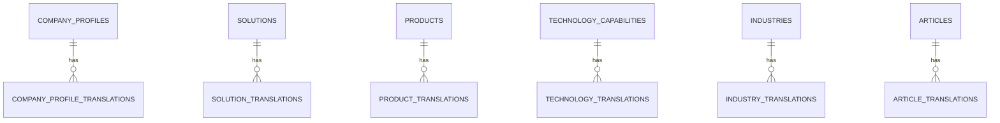

# VERINEX 数据库设计文档

> 项目：VERINEX TECHNOLOGIES 官方网站  
> 文档：DATABASE.md  
> 版本：V1.1  
> 数据库：MySQL 8.4 LTS  
> ORM：Entity Framework Core 10  
> 字符集：utf8mb4  
> 状态：开发基线，已与 PRD V1.1、API V1.1 对齐

## 1. 设计目标

数据库用于持久化 VERINEX 官网的企业介绍、业务解决方案、产品平台、技术能力、行业分类、文章、网站配置、媒体元数据和客户联系留言。

设计原则：

1. 业务主数据与中英文翻译分离。
2. 内容发布状态与产品成熟度状态分离。
3. 公开接口只读取已发布内容。
4. 联系留言必须持久化，不能只保存在前端或内存中。
5. 表结构简单、约束明确，避免为尚未实施的后台功能过度设计。
6. 数据库结构统一由 EF Core Migrations 管理。

## 2. 数据库基本规范

| 项目 | 规范 |
|---|---|
| 数据库 | `verinex` |
| 推荐版本 | MySQL 8.4 LTS |
| 字符集 | `utf8mb4` |
| 排序规则 | `utf8mb4_0900_ai_ci`（部署版本支持时使用） |
| 表名 | snake_case，统一使用复数 |
| 主键 | `BIGINT` 自增 |
| 时间 | `DATETIME(3)`，统一按 UTC 写入 |
| 布尔值 | `TINYINT(1)` / EF Core bool |
| JSON | 仅用于不需要复杂关系查询的结构化配置 |
| 删除策略 | 内容优先使用状态归档；关联翻译随主记录删除；留言不因内容删除而级联删除 |

所有实体应包含必要的创建和更新时间。EF Core 配置必须明确字段长度、精度、索引、外键和删除行为，不依赖数据库隐式默认值。

## 3. 双语数据模型

支持语言：

- `zh-CN`
- `en`

公司介绍、解决方案、产品、技术能力、行业和文章采用“主表 + 翻译表”。

主表保存语言无关字段，例如 code、状态、排序、产品成熟度、发布时间和媒体关联。翻译表保存 locale、slug、名称、标题、摘要、正文和 SEO 文案。

约束：

- 同一主记录的 locale 唯一：`UNIQUE (entity_id, locale)`。
- 同一内容类型下同一语言的 slug 唯一：`UNIQUE (locale, slug)`。
- locale 只允许 `zh-CN` 或 `en`。
- 公开查询必须同时满足主记录已发布、目标语言翻译存在且有效。
- 目标语言没有已发布翻译时返回未找到或明确的语言缺失状态，不得静默混用另一语言正文。

## 4. 核心数据表

### 4.1 `company_profiles` — 企业基础信息

用于保存企业主体的语言无关信息。MVP 通常只有一条当前生效记录。

| 字段 | 类型 | 约束/说明 |
|---|---|---|
| id | BIGINT | PK, AUTO_INCREMENT |
| code | VARCHAR(50) | NOT NULL, UNIQUE，建议 `main` |
| is_active | TINYINT(1) | NOT NULL, DEFAULT 1 |
| created_at | DATETIME(3) | NOT NULL |
| updated_at | DATETIME(3) | NOT NULL |

### 4.2 `company_profile_translations` — 企业介绍翻译

| 字段 | 类型 | 约束/说明 |
|---|---|---|
| id | BIGINT | PK, AUTO_INCREMENT |
| company_profile_id | BIGINT | FK -> company_profiles.id |
| locale | VARCHAR(10) | NOT NULL，`zh-CN` / `en` |
| company_name | VARCHAR(160) | NOT NULL |
| brand_name | VARCHAR(100) | NOT NULL |
| tagline | VARCHAR(255) | NULL |
| overview | TEXT | NULL |
| mission | TEXT | NULL |
| vision | TEXT | NULL |
| values_text | TEXT | NULL |
| seo_title | VARCHAR(255) | NULL |
| seo_description | VARCHAR(500) | NULL |
| created_at | DATETIME(3) | NOT NULL |
| updated_at | DATETIME(3) | NOT NULL |

约束：`UNIQUE(company_profile_id, locale)`；外键删除策略按主记录生命周期设置为 CASCADE。

`values_text` 以 JSON 字符串数组存储核心价值观（如 `["真实","专业","创新","责任"]`），API 输出为 `values: string[]`，不为此单独建表。

### 4.3 `solutions` — 解决方案主表

| 字段 | 类型 | 约束/说明 |
|---|---|---|
| id | BIGINT | PK, AUTO_INCREMENT |
| code | VARCHAR(80) | NOT NULL, UNIQUE，稳定业务编码 |
| content_status | VARCHAR(20) | NOT NULL，DRAFT / PUBLISHED / ARCHIVED |
| sort_order | INT | NOT NULL, DEFAULT 0 |
| is_featured | TINYINT(1) | NOT NULL, DEFAULT 0 |
| created_at | DATETIME(3) | NOT NULL |
| updated_at | DATETIME(3) | NOT NULL |

### 4.4 `solution_translations` — 解决方案翻译

| 字段 | 类型 | 约束/说明 |
|---|---|---|
| id | BIGINT | PK, AUTO_INCREMENT |
| solution_id | BIGINT | FK -> solutions.id |
| locale | VARCHAR(10) | NOT NULL |
| slug | VARCHAR(180) | NOT NULL |
| title | VARCHAR(180) | NOT NULL |
| subtitle | VARCHAR(255) | NULL |
| summary | VARCHAR(600) | NOT NULL |
| body_markdown | LONGTEXT | NULL，详情内容；渲染前必须安全处理 |
| seo_title | VARCHAR(255) | NULL |
| seo_description | VARCHAR(500) | NULL |
| created_at | DATETIME(3) | NOT NULL |
| updated_at | DATETIME(3) | NOT NULL |

约束：`UNIQUE(solution_id, locale)`、`UNIQUE(locale, slug)`；索引 `slug` 与 `solution_id`。

### 4.5 `products` — 产品主表

| 字段 | 类型 | 约束/说明 |
|---|---|---|
| id | BIGINT | PK, AUTO_INCREMENT |
| code | VARCHAR(80) | NOT NULL, UNIQUE，如 VERICORPUS |
| product_stage | VARCHAR(24) | NOT NULL，PLANNED / IN_DEVELOPMENT / RELEASED |
| content_status | VARCHAR(20) | NOT NULL，DRAFT / PUBLISHED / ARCHIVED |
| sort_order | INT | NOT NULL, DEFAULT 0 |
| is_featured | TINYINT(1) | NOT NULL, DEFAULT 0 |
| cover_image_url | VARCHAR(1000) | NULL，封面图 URL（前端静态资源路径或对象存储地址） |
| created_at | DATETIME(3) | NOT NULL |
| updated_at | DATETIME(3) | NOT NULL |

`content_status` 决定内容是否公开；`product_stage` 决定产品成熟度，两者不能混为一谈。规划中的产品可以展示为“规划中”，但不得显示为已上线。

V1 不启用媒体资源表，封面直接存 URL，API 字段名为 `coverImage`。

### 4.6 `product_translations` — 产品翻译

| 字段 | 类型 | 约束/说明 |
|---|---|---|
| id | BIGINT | PK, AUTO_INCREMENT |
| product_id | BIGINT | FK -> products.id |
| locale | VARCHAR(10) | NOT NULL |
| slug | VARCHAR(180) | NOT NULL |
| name | VARCHAR(180) | NOT NULL |
| subtitle | VARCHAR(255) | NULL |
| summary | VARCHAR(600) | NOT NULL |
| description | LONGTEXT | NULL |
| features_json | JSON | NULL，功能点数组；不用于复杂筛选 |
| seo_title | VARCHAR(255) | NULL |
| seo_description | VARCHAR(500) | NULL |
| created_at | DATETIME(3) | NOT NULL |
| updated_at | DATETIME(3) | NOT NULL |

约束：`UNIQUE(product_id, locale)`、`UNIQUE(locale, slug)`。

### 4.7 `technology_capabilities` — 技术能力主表

| 字段 | 类型 | 约束/说明 |
|---|---|---|
| id | BIGINT | PK, AUTO_INCREMENT |
| code | VARCHAR(80) | NOT NULL, UNIQUE |
| content_status | VARCHAR(20) | NOT NULL，DRAFT / PUBLISHED / ARCHIVED |
| sort_order | INT | NOT NULL, DEFAULT 0 |
| created_at | DATETIME(3) | NOT NULL |
| updated_at | DATETIME(3) | NOT NULL |

### 4.8 `technology_translations` — 技术能力翻译

| 字段 | 类型 | 约束/说明 |
|---|---|---|
| id | BIGINT | PK, AUTO_INCREMENT |
| technology_capability_id | BIGINT | FK -> technology_capabilities.id |
| locale | VARCHAR(10) | NOT NULL |
| title | VARCHAR(180) | NOT NULL |
| summary | VARCHAR(600) | NULL |
| description | LONGTEXT | NULL |
| created_at | DATETIME(3) | NOT NULL |
| updated_at | DATETIME(3) | NOT NULL |

约束：`UNIQUE(technology_capability_id, locale)`。

### 4.9 `industries` — 行业主表

| 字段 | 类型 | 约束/说明 |
|---|---|---|
| id | BIGINT | PK, AUTO_INCREMENT |
| code | VARCHAR(80) | NOT NULL, UNIQUE |
| content_status | VARCHAR(20) | NOT NULL，DRAFT / PUBLISHED / ARCHIVED |
| sort_order | INT | NOT NULL, DEFAULT 0 |
| created_at | DATETIME(3) | NOT NULL |
| updated_at | DATETIME(3) | NOT NULL |

### 4.10 `industry_translations` — 行业翻译

| 字段 | 类型 | 约束/说明 |
|---|---|---|
| id | BIGINT | PK, AUTO_INCREMENT |
| industry_id | BIGINT | FK -> industries.id |
| locale | VARCHAR(10) | NOT NULL |
| title | VARCHAR(180) | NOT NULL |
| summary | VARCHAR(600) | NULL |
| description | TEXT | NULL |
| created_at | DATETIME(3) | NOT NULL |
| updated_at | DATETIME(3) | NOT NULL |

约束：`UNIQUE(industry_id, locale)`。

### 4.11 `articles` — 文章主表

| 字段 | 类型 | 约束/说明 |
|---|---|---|
| id | BIGINT | PK, AUTO_INCREMENT |
| category_code | VARCHAR(80) | NOT NULL，固定分类编码 |
| content_status | VARCHAR(20) | NOT NULL，DRAFT / PUBLISHED / ARCHIVED |
| is_featured | TINYINT(1) | NOT NULL, DEFAULT 0 |
| published_at | DATETIME(3) | NULL，UTC |
| cover_image_url | VARCHAR(1000) | NULL，封面图 URL |
| created_at | DATETIME(3) | NOT NULL |
| updated_at | DATETIME(3) | NOT NULL |

建议初始分类编码：`ai-technology`、`enterprise-ai`、`data-intelligence`、`brand-intelligence`、`industry-research`。分类名称由前端 i18n 或后续分类翻译表提供，不能在中英文页面混用。

相关推荐（`relatedArticles`）不建关联表，由查询按“同分类 + 时间倒序 + 最多 3 条 + 不足时用最新文章补齐”生成，规则见 `docs/API.md` 5.10。

### 4.12 `article_translations` — 文章翻译

| 字段 | 类型 | 约束/说明 |
|---|---|---|
| id | BIGINT | PK, AUTO_INCREMENT |
| article_id | BIGINT | FK -> articles.id |
| locale | VARCHAR(10) | NOT NULL |
| slug | VARCHAR(200) | NOT NULL |
| title | VARCHAR(240) | NOT NULL |
| excerpt | VARCHAR(800) | NULL |
| content_markdown | LONGTEXT | NOT NULL，展示前安全渲染 |
| seo_title | VARCHAR(255) | NULL |
| seo_description | VARCHAR(500) | NULL |
| created_at | DATETIME(3) | NOT NULL |
| updated_at | DATETIME(3) | NOT NULL |

约束：`UNIQUE(article_id, locale)`、`UNIQUE(locale, slug)`。索引文章主表的 `(content_status, published_at)`。

### 4.13 `contact_messages` — 客户联系留言

| 字段 | 类型 | 约束/说明 |
|---|---|---|
| id | BIGINT | PK, AUTO_INCREMENT |
| name | VARCHAR(100) | NOT NULL |
| company_name | VARCHAR(160) | NOT NULL |
| email | VARCHAR(254) | NOT NULL |
| phone | VARCHAR(40) | NULL |
| industry_code | VARCHAR(80) | NULL，对应 industries.code，未填写时为空 |
| cooperation_type | VARCHAR(80) | NOT NULL，对应业务板块固定编码 |
| target_product_code | VARCHAR(80) | NULL，对应 products.code 或 `unsure` |
| message | VARCHAR(5000) | NOT NULL |
| locale | VARCHAR(10) | NOT NULL，zh-CN / en |
| privacy_consent | TINYINT(1) | NOT NULL |
| privacy_policy_version | VARCHAR(40) | NOT NULL |
| status | VARCHAR(20) | NOT NULL，NEW / PROCESSING / REPLIED / CLOSED |
| created_at | DATETIME(3) | NOT NULL |
| processed_at | DATETIME(3) | NULL |

`industry_code` 与 `target_product_code` 只存编码，不建外键：行业或产品后续下线、改名不应影响历史留言。当前有效隐私政策版本保存在 `site_settings`（`setting_key = privacy_policy_version`），服务端校验时读取该值。

索引：`(status, created_at)`、`(created_at)`。邮箱可按业务需要建立普通索引，不建议将个人信息放入不必要的复合索引。

隐私要求：只收集联系所需字段；默认不保存完整 IP 地址；日志不得输出完整留言。数据保留期限、删除流程和隐私政策版本由项目负责人在上线前确认。

### 4.14 `site_settings` — 网站配置

用于保存公开的站点级配置，例如联系邮箱、社交链接、首页展示开关和少量全局配置。

| 字段 | 类型 | 约束/说明 |
|---|---|---|
| id | BIGINT | PK, AUTO_INCREMENT |
| setting_key | VARCHAR(120) | NOT NULL |
| locale | VARCHAR(10) | NOT NULL，语言无关配置使用 `und` |
| value_json | JSON | NOT NULL |
| is_public | TINYINT(1) | NOT NULL, DEFAULT 0 |
| updated_at | DATETIME(3) | NOT NULL |

约束：`UNIQUE(setting_key, locale)`。公开 API 只能返回 `is_public = 1` 的配置。不得将密钥、密码或内部配置写入此表。

V1 至少包含：`contact_email`（is_public=1）、`privacy_policy_version`（is_public=1，联系表单校验依据）、`icp_number`（is_public=1）、`social_links`（is_public=1，JSON 数组）。

### 4.15 `media_assets` — 媒体资源元数据（第二阶段，V1 不启用）

| 字段 | 类型 | 约束/说明 |
|---|---|---|
| id | BIGINT | PK, AUTO_INCREMENT |
| storage_provider | VARCHAR(30) | NOT NULL，如 local / object-storage / external |
| object_key | VARCHAR(500) | NULL，存储对象标识 |
| public_url | VARCHAR(1000) | NOT NULL |
| mime_type | VARCHAR(120) | NOT NULL |
| file_size_bytes | BIGINT | NULL |
| width | INT | NULL |
| height | INT | NULL |
| created_at | DATETIME(3) | NOT NULL |

如需多语言 alt 文本，可增加 `media_asset_translations(id, media_asset_id, locale, alt_text)`，并对 `(media_asset_id, locale)` 建唯一约束。

V1 不创建该表：产品和文章封面使用 `cover_image_url` 存 URL。只有在实现后台上传与媒体管理时才启用本表，并在那时为 `products` / `articles` 增加外键或等价关联，通过 Migration 完成。

## 5. 表关系概览

每个翻译表通过外键关联对应主表。主表和翻译表是一对多关系，一个主记录最多有 zh-CN、en 两种当前语言记录。`contact_messages` 与 `site_settings` 为独立表，无外键关联；留言中的行业与产品编码按值引用，不建外键。

## 6. 索引与约束原则

必须建立：

- 所有主键。
- 所有 `code` 唯一索引。
- 所有翻译表的 `(parent_id, locale)` 唯一索引。
- 所有 slug 的 `(locale, slug)` 唯一索引。
- 内容主表的 `(content_status, sort_order)` 或适合查询模式的组合索引。
- 文章的 `(content_status, published_at)` 索引。
- 留言的 `(status, created_at)` 索引。
- 外键索引。

索引应根据真实查询验证，不要为每个字段盲目添加索引。唯一索引必须与 API 的 slug 查询方式一致。

## 7. 初始化数据与内容真实性

初始化数据应通过可重复执行的 Seed 或受控 SQL 脚本提供，并满足幂等要求：

- 使用稳定 `code` 识别记录，不依赖自增 ID 固定值。
- 重复执行不能产生重复记录。
- 不得覆盖已由人工维护的正式内容，除非明确采用受控更新策略。
- 初始产品成熟度默认为 PLANNED，只有项目负责人确认已上线后才设置 RELEASED。
- 不得虚构客户、合作伙伴、奖项、资质、专利、营收、用户数或实际项目案例。
- 文章内容如为演示数据，必须明确标记为示例，不得伪装成真实新闻或研究报告。

## 8. EF Core 实施约定

- 使用 `AppDbContext` 管理 DbSet。
- 使用 Fluent API 配置表名、列名、长度、索引、唯一约束、外键和删除行为。
- Entity 属性与数据库列映射必须明确。
- 统一时间处理为 UTC。
- 使用 Migration 管理结构变化。
- Migration 文件必须纳入版本控制。
- 不得在应用每次启动时自动执行未经审查的生产迁移。
- MySQL Provider 必须与 EF Core 10 兼容；安装前核对官方版本支持情况。

## 9. 备份、隐私与运维

- 生产数据库必须配置持久化卷和定期备份。
- 备份恢复流程需要实际演练。
- 数据库端口不直接暴露公网。
- 数据库账号遵循最小权限原则，应用账号不使用 root。
- 联系留言属于个人信息，限制管理访问并定义保留期限。
- 生产日志不得包含连接字符串、密码、Token 或完整留言。
- 数据删除、恢复和破坏性迁移必须经过人工确认。

## 10. MVP 与后续阶段

### MVP 必需

- company_profiles / translations
- solutions / translations
- products / translations
- technology_capabilities / translations
- industries / translations
- articles / translations
- contact_messages
- site_settings

### 按需启用（第二阶段）

- media_assets：实现后台上传或媒体管理时启用。
- media_asset_translations：需要多语言 alt 文本时启用。

### 第二阶段

- admin_users
- admin_roles
- admin_permissions
- 管理操作审计表

后台认证与权限模型必须在第二阶段 PRD 中确认后再实施，MVP 不提前创建无用的后台系统。

**文档结束**
